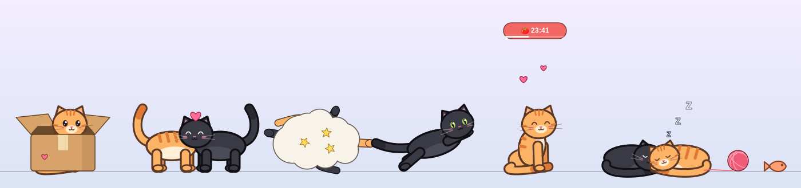

# Desktop Cat 🐱🐈‍⬛

Two cute cats that live on your Linux desktop. They wander around, jump onto your windows,
play with each other and nap. They also double as a focus buddy: a Pomodoro timer, a
distraction guard, and break reminders.



## Install

**Requirements:** a Wayland compositor with `wlr-layer-shell` (Hyprland, Sway, river, niri,
KDE Plasma, Wayfire…), Python 3, GTK 3, and `gtk-layer-shell`.
GNOME is not supported, because it doesn't implement layer-shell.

```bash
git clone https://github.com/ByteB1itz420/desktop-cat.git
cd desktop-cat
./install.sh
```

The installer pulls in the dependencies on Arch, Debian/Ubuntu, Fedora and openSUSE. It then
sets up a systemd user service, so the cats start at every login and restart automatically if
anything goes wrong.

To try it without installing, run `./desktop-cat`. To remove it, run `./uninstall.sh` (add
`--purge` to also delete settings).

> On **Hyprland** the cats see your windows: they jump onto them, ride along when you move
> them, and the distraction guard can see what you're looking at. On other compositors they
> stay on the bottom of the screen.

## Playing with them

| Action | What happens |
|---|---|
| Click / stroke / scroll on a cat | Petting: purrs and hearts. Head scratches are best; touching the tail is risky 😾 |
| **Press & hold** or right-click a cat | Opens the cat's menu |
| Double-click | Happy hop |
| Drag & throw | Pick up a cat, the yarn ball, the box or a treat and toss it |
| Middle-click | Toss a treat 🐟 |
| Click the box / ball | A cat hops in / the ball bounces |
| Click the timer badge | Pause / resume |

**What they get up to:** walking, zoomies, jumping onto windows, pouncing on your cursor,
grooming, kneading, stretching, slow-blinking at you, chasing their tails, sitting in the
cardboard box ("if I fits I sits"), scratching it, batting the yarn ball, and getting annoyed
if you over-pet them.

**Together** they boop noses, play chase, play-fight in a cartoon dust cloud, groom each
other, and cuddle up to sleep.

**Multiple monitors:** each screen gets its own overlay. Plug in a monitor and the second cat
walks over to it, and the cats visit each other across screens.

**Treats & bond:** you get 10 free treats a day, plus 3 for every completed focus session.
Each cat has a bond meter that grows with pets, treats and play, and they get hungry over time.

## Productivity

Open a cat's menu and pick **🍅 Start focus** or **📋 Focus & productivity**:

- Pomodoro focus sessions with short and long breaks, plus a timer badge above the cat
- A focus goal that the cats remind you of
- Calm mode: the cats mostly nap while you work
- Distraction guard: on Hyprland, the cats nudge you if you open YouTube, Reddit, etc. during focus
- Reminders for water, stretching, 20-20-20 eye rest, and bedtime
- Daily stats

## Battery friendly

- The cats only animate quickly when something is moving.
- On battery or power-saver mode the frame rate drops further.
- Below 20% battery (configurable) they go to sleep until you plug in.

## Keybinds & scripting

```bash
desktop-cat menu | treat | pet | play | focus | pause | stop | hide | show
```

Example for Hyprland: `bind = SUPER, C, exec, desktop-cat menu`

## Settings & data

- Settings: menu → ⚙️ Settings, or `~/.config/desktop-cat/config.json`
  (names, coats: ginger / grey / black / cream / tuxedo, size, energy, toys, timers, reminders)
- Stats and bond: `~/.local/share/desktop-cat/`
- Service: `systemctl --user stop|start|restart desktop-cat` · logs: `journalctl --user -u desktop-cat`

## Development

The cats are drawn procedurally with cairo, so there are no image assets. The sounds are
synthesized too.

- `catpet/cat.py`: behaviour and physics
- `catpet/render.py`: art
- `catpet/app.py`: overlays and input
- `catpet/toys.py`, `catpet/focus.py`, `catpet/menu.py`
- `python3 preview.py` renders every pose to a PNG

## License

MIT
